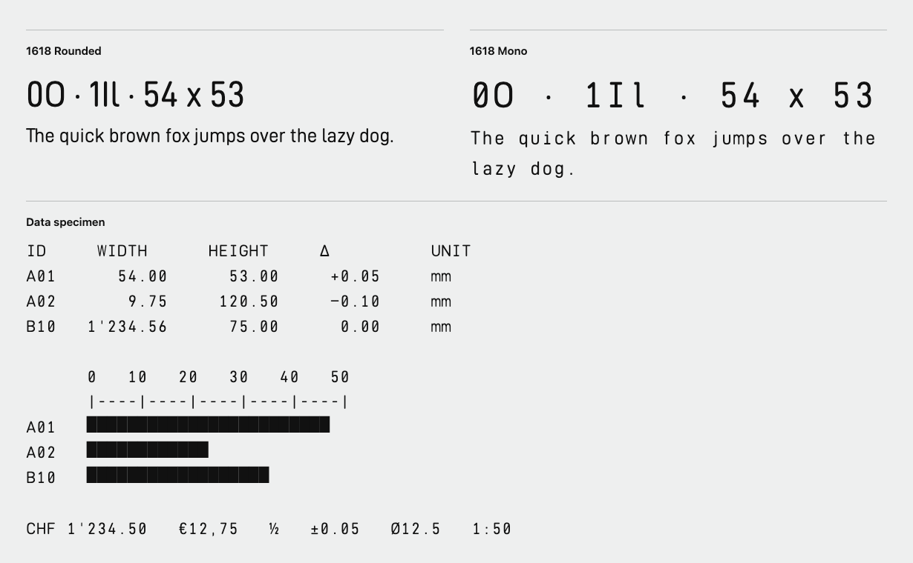

# 1618 Rounded and 1618 Mono

**1618 design and adaptation author: Matthias A. Peterseim.**

1618 Rounded is a proportional, engraving-inspired typeface with eight weights and matching obliques. 1618 Mono is its fixed-width companion for tables, charts and measurement readouts. Both families have eight weights and matching obliques. Version 1.1 gives the heavier Rounded cuts more space.

[Download the finished release in OTF and WOFF2](https://github.com/alberti1492/datto-d-din/releases/tag/1618-v1.1) · [Online specimen](https://1618instruments.com/fonts/) · [Weight specimen](https://1618instruments.com/fonts/weights.html)

The 1618 designs are derived from Datto D-DIN Regular, designed by Charles Nix at Monotype, and use additional outlines from the Noto font project. Both families are distributed under the SIL Open Font License 1.1. [Licence and upstream notices](OFL.txt) · [Font log](FONTLOG.txt)

Upstream sources are [Datto D-DIN, build 100](https://github.com/amcchord/datto-d-din/tree/e199c8441e758d6e492cd01ef52c3c67ba4bae26) and [Noto Sans, Noto Sans Math, Noto Sans Symbols and Noto Sans Symbols 2](https://github.com/google/fonts/tree/5bb28733cec313b63fbd415b574b5ae35c8aa8b8).
